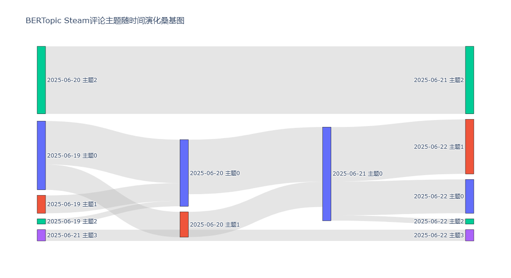
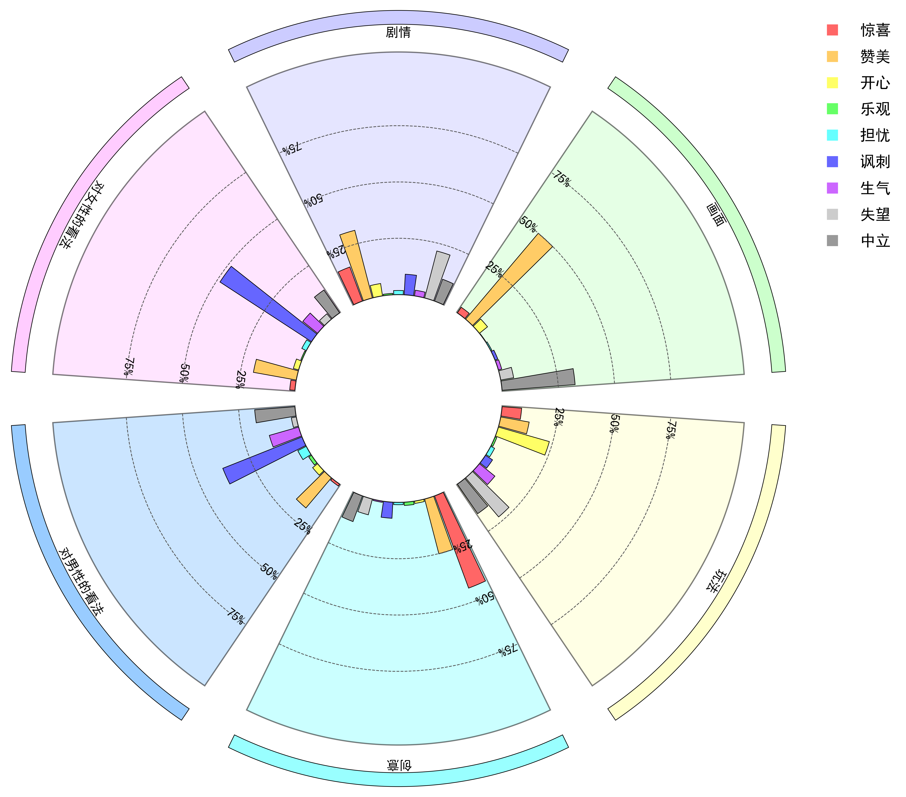

# 《捞女游戏》评论分析与性别对立研究

## 项目简介

本项目基于 **《捞女游戏》** 的评论分析，结合数据分析和情感分析方法，探讨该游戏在 Steam 平台上的评论区引发的性别对立与社会议题。我们从 **性别对立、情感分析** 和 **主题建模** 等角度深入分析了游戏的评论，揭示了网络舆论的演化及其对性别议题的影响。

### 相关文档

- **《捞女游戏》评论分析报告**：该PDF文件详细分析了 Steam 上的评论，探索了游戏如何引发性别对立的讨论，并从多维度（情感、话题、性别）对评论进行分类和分析。该报告仅供参考，进一步了解游戏舆论的动态。

---

## 项目分析内容

### 数据来源与分析方法
1. **评论数据**：基于 Steam 平台的用户评论，数据爬取时间为 2025 年 6 月 19 日至 2025 年 6 月 23 日。评论内容被用于情感分析和主题建模。
2. **分析方法**：使用 **机器学习**、**情感分析** 和 **主题建模（如 LDA、BERTopic）** 对评论进行处理，揭示不同用户群体的意见分布与情感表达。

---

## 结果展示

### 关键词分析
通过 **TF-IDF** 和 **词频统计**，我们揭示了评论中的核心话题，包括“剧情”、“社会性别问题”、“反诈教育”等。

### 情感分析
使用情感分析工具，结合大语言模型（LLM），对评论进行了法面级情感分析，结果显示**性别问题**和**游戏剧情**是评论中的主要关注点。

### 主题建模
使用 **BERTopic** 模型对评论进行了聚类，找出了 4 个主要话题，具体如下：
- **剧情精彩好评**
- **现实与DLC扩展**
- **Steam 游戏评价与争议**
- **2025 年度最佳游戏**

---

### 图片展示

#### 1. **桑基图**  

#### 2. **shap值特征分析**  

#### 3. **情感类型分布图**  

---

## 代码与数据

所有分析的代码、数据和论文已上传至本仓库。请根据需要自行下载并运行分析代码，论文仅供参考，请勿直接抄袭。

---

**备注**：该项目的内容主要用于学术研究与讨论，若用于其他场合，请务必标明出处。
